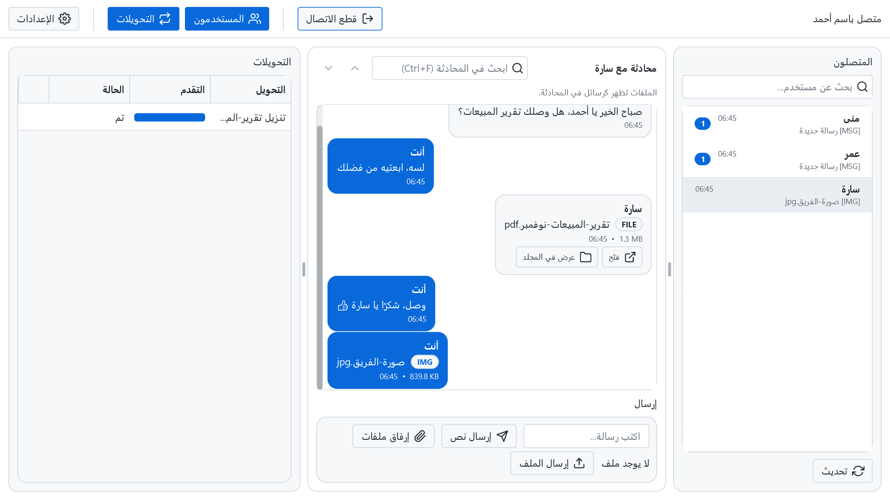
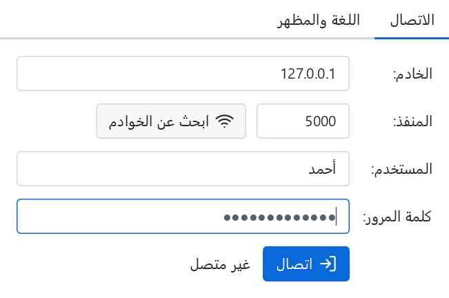
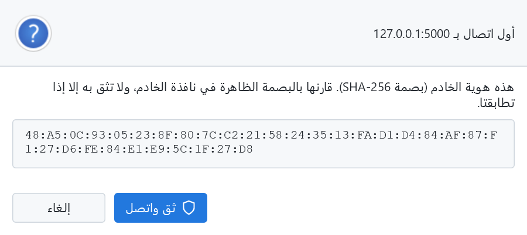
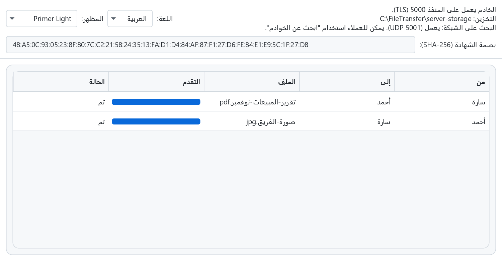

# File Transfer

**العربية** | [English](README.en.md)

       

برنامج JavaFX لنقل الملفات والمحادثة بين الأجهزة على الشبكة المحلية (LAN)، أشبه بـ "واتساب للملفات": سيرفر واحد وأي عدد من العملاء يتواصلون عبر TCP Sockets مباشرة، بدون إنترنت وبدون قاعدة بيانات.

## صور من البرنامج



*نافذة العميل: المتصلون مع عدد الرسائل غير المقروءة، والمحادثة مع ملف تم تنزيله، ولوحة التحويلات.*

| الإعدادات: الاتصال بالسيرفر | أول اتصال: مقارنة بصمة السيرفر قبل الثقة فيه |
|---|---|
|  |  |



*نافذة السيرفر: المنفذ، ومجلد التخزين، وبصمة الشهادة، وجدول الملفات المنقولة.*

## المميزات

### المحادثة والملفات
- **محادثة نصية وإرسال ملفات** بين المستخدمين، مع حفظ سجل كل محادثة على السيرفر. زرار "إرفاق ملفات" بيختار ملف أو أكتر مرة واحدة (Ctrl أو Shift مع الضغط)، وكل ملف بيتبعت في نقل لوحده.
- **حذف الرسائل**: كليك يمين على أي رسالة (أو زرار Delete) ثم "حذف...". "حذف لدي" بيشيلها من محادثتك انت بس، و"حذف لدى الجميع" (لرسايلك انت بس) بيشيلها عند الطرفين ويسيب مكانها "تم حذف هذه الرسالة"، ولو كانت ملف بيتمسح من السيرفر. الطرف التاني بيشوف الحذف على طول من غير ما يعمل حاجة.
- **البحث في المحادثة**: خانة بحث فوق المحادثة المفتوحة (Ctrl+F) بتدوّر في الرسايل وأسماء الملفات، وبتعلّم على النتائج، وEnter بيروح للأقدم وShift+Enter للأحدث. البحث مش بيفرق بين الحروف الكبيرة والصغيرة، ولا بيهتم بالتشكيل والتطويل، و"احمد" بيلاقي "أحمد"، و"مكتبه" بيلاقي "مكتبة".
- **أزرار على فقاعة الملف**: "تنزيل" للملف اللي لسه ما اتنزّلش، و"فتح" و"عرض في المجلد" للملف اللي على جهازك (اللي نزّلته، أو اللي انت بعته). البرنامج بيفتكرهم بعد ما تقفله وتفتحه. ولو الملف ممكن يشغّل برامج (زي `.exe` أو `.bat`)، بيسألك الأول، والاختيار الافتراضي "إلغاء".
- **اسحب وأفلت**: اسحب ملفًا أو أكثر من الـ Explorer على المحادثة المفتوحة، فيتبعتوا على طول. وأثناء السحب بيظهر إطار بيقول هيتبعت إيه ولمين، أو ليه مش هينفع (مثلًا لو مش متصل، أو مفيش مستخدم مختار). المجلدات بتتجاهل.
- **إشعارات فورية**: السيرفر يرسل للمستلم الرسائل والملفات الجديدة لحظة وصولها.
- **إشعارات سطح المكتب**: لو البرنامج مش قدامك ووصلتك رسالة أو ملف، بيظهر إشعار من النظام فيه اسم الباعت (من غير نص الرسالة)، والضغط عليه بيفتح المحادثة. وعدد الرسائل غير المقروءة بيظهر في عنوان النافذة وشريط المهام، زي "(3)". تقدر توقف الإشعارات من الإعدادات.
- **نقل ملفات متوازٍ**: كل رفع أو تنزيل يفتح اتصالًا منفصلًا، فلا يوقف المحادثة، ويمكن تشغيل أكثر من نقل في نفس الوقت.
- **لوحة النقل**: متابعة حالة الرفع والتنزيل وسبب الفشل إن حدث، مع إمكانية إخفائها. زرار ✕ جنب أي نقل شغال بيوقفه في نصه: الرفع الملغي بيتمسح من السيرفر ومحدش بيتبلّغ بيه، والتنزيل الملغي بيتمسح من جهازك، والمحادثة وباقي النقل بيكملوا عادي.
- حد أقصى لحجم الملف **200 MB**، وللرسالة النصية **2000 حرف**.

### الواجهة
- **شاشة إعدادات**: زرار ⚙ الإعدادات يفتح تبويب "الاتصال" (الخادم والمنفذ والمستخدم وكلمة المرور) وتبويب "اللغة والمظهر". الشريط العلوي فيه حالة الاتصال وزرار اتصال/قطع الاتصال بس. وعند الفتح، تبويب الاتصال بيظهر لوحده.
- **قوائم جانبية مرنة**: اسحب الفاصل بين القوائم لتكبير أو تصغير قائمة المستخدمين أو التحويلات، وأخفِ أي واحدة أو أظهرها بزرارها في الشريط العلوي. العرض والقوائم الظاهرة بيتحفظوا للمرة الجاية.
- **البحث عن السيرفر تلقائيًا**: زرار "ابحث عن الخوادم" يعرض السيرفرات الموجودة على نفس الشبكة، ويملأ العنوان والمنفذ بضغطة.
- **يفتكر آخر دخول**: العنوان والمنفذ واسم المستخدم يتملوا لوحدهم عند الفتح، والمطلوب كلمة المرور بس (كلمة المرور لا تُحفظ). واللغة والمظهر اللي اخترتهم يرجعوا كمان.
- **قائمة مستخدمين ذكية**: عدد الرسائل غير المقروءة، معاينة آخر رسالة، بحث، وترتيب حسب غير المقروء ثم آخر نشاط.
- **وقت مفهوم** في فقاعات المحادثة والقائمة الجانبية: الساعة فقط لرسائل اليوم، ثم "أمس"، ثم التاريخ. التاريخ الكامل يظهر عند الوقوف على وقت الرسالة، والأوقات تتحدّث تلقائيًا بعد منتصف الليل.
- **واجهة بالعربية والإنجليزية** مع التبديل أثناء التشغيل، واتجاه من اليمين لليسار للعربية.
- **رسائل الخطأ مترجمة**: السيرفر يرسل كود الخطأ فقط، والعميل يعرضه بلغة الواجهة.
- **ثيمات متعددة** من AtlantaFX (Primer و Nord و Cupertino بالوضعين الفاتح والداكن، و Dracula).
- **أيقونات للأزرار** من مكتبة Ikonli (مجموعة Feather)، ولونها بيتبع الثيم تلقائيًا في الفاتح والداكن.
- **واجهة للسيرفر** تعرض جدول عمليات النقل وتقدّم كل منها، بالعربية أو الإنجليزية وبأي ثيم، وبتفتكر اختيارك.

### الحسابات
- أول دخول باسم جديد يسجّل الحساب، وكلمات المرور محفوظة كـ hash (PBKDF2).
- أسماء المستخدمين لا تفرّق بين الحروف الكبيرة والصغيرة (`Ali` و `ali` نفس الحساب)، وتقبل الحروف العربية.
- جلسة واحدة لكل مستخدم: الدخول من جهاز جديد يغلق الجلسة القديمة، فلو انقطع جهاز فجأة لا يمنع صاحبه من الدخول مرة أخرى.

## المتطلبات

- JDK 21
- لا تحتاج تثبيت Maven، فالمشروع يحتوي على Maven Wrapper (`mvnw` / `mvnw.cmd`).

## التشغيل السريع

```powershell
.\mvnw.cmd -Pserver javafx:run     # تشغيل السيرفر (يستمع على المنفذ 5000)
.\mvnw.cmd -Pclient javafx:run     # تشغيل عميل (شغّل أكثر من واحد في نوافذ مختلفة)
```

على Linux أو macOS استخدم `./mvnw` بدل `.\mvnw.cmd`.

### منفذ أو مجلد تخزين مختلف

لو المنفذ 5000 مشغول، أو عاوز تحفظ البيانات في مكان تاني:

```powershell
.\mvnw.cmd -Pserver javafx:run "-Djavafx.args=--port 5050 --storage D:\ft-data"
```

أو اكتبهم مرة واحدة في ملف `server.properties` في مجلد التشغيل:

```properties
port=5050
storage=D:/ft-data
```

خيارات سطر الأوامر تتقدّم على الملف، والملف يتقدّم على القيم الافتراضية (`5000` و `server-storage`). نافذة السيرفر تعرض المنفذ والمجلد المستخدمين فعلًا، ولو المنفذ مشغول تقول ده بوضوح. في العميل اكتب نفس المنفذ في خانة `Port`.

التفاصيل الكاملة (خانات واجهة العميل، الحسابات، إعدادات الشبكة والجدار الناري) في [docs/RUNNING.md](docs/RUNNING.md).

### ملفات التثبيت (Windows و Linux و macOS)

لتسليم البرنامج لأجهزة مافيهاش Java. سكربت واحد بيبني ملف تثبيت النظام اللي شغّال عليه، وبيشغّل الاختبارات الأول:

```powershell
.\packaging\package.ps1                  # Windows: target\installer\File Transfer-<version>.exe
.\packaging\package.ps1 -Type app-image  # مجلد يتضغط ويشتغل من غير تثبيت
.\packaging\package.ps1 -SkipTests       # من غير الاختبارات
```

السكربت محتاج نسخة من [desktop-updater](https://github.com/MohamedSalah-13/desktop-updater) جنب المشروع (أو في `DESKTOP_UPDATER_HOME`)، زي `release.ps1`: الخطوات المشتركة بين البرامج في `tools/Packaging.psm1` هناك.

| النظام | الملف | فيه |
|---|---|---|
| Windows | `File Transfer-<version>.exe` | البرنامجين، باختصار لكل واحد في قائمة Start وعلى سطح المكتب |
| Linux | `FileTransfer-<version>-linux-<arch>.deb` | البرنامجين، بمدخل لكل واحد في قائمة البرامج |
| macOS | `FileTransfer-<version>-macos-<arch>.dmg` و `FileTransferServer-<version>-macos-<arch>.dmg` | تطبيق في كل ملف، لأن تطبيق macOS ليه أيقونة واحدة |

كل ملف تثبيت فيه Java الخاصة بيه. نسخة Windows مش محتاجة صلاحيات مدير، وبتضيف اختصارين: **File Transfer** (العميل) و **File Transfer Server**. السيرفر المثبّت بيحفظ بياناته و `server.properties` في `~/.file-transfer/server` (على Windows: `%USERPROFILE%\.file-transfer\server`)، فإلغاء التثبيت أو الترقية ما بيمسحش الحسابات ولا الملفات ولا الشهادة.

`jpackage` بيبني لنظامه بس، فملفات Linux و macOS (Apple Silicon و Intel) بتتبني على أجهزة GitHub في [`.github/workflows/packages.yml`](.github/workflows/packages.yml): لما إصدار يتنشر بـ `packaging
elease.ps1` (من Windows زي الأول) الـ workflow بيضيف الـ `.deb` والـ `.dmg` لنفس الإصدار، ولو PR غيّر التغليف بيحفظهم مع التشغيل (Artifacts) من غير نشر. وتقدر تشغّله بإيدك من تبويب Actions لإصدار موجود.

- **Linux:** `sudo apt install ./FileTransfer-<version>-linux-x64.deb`. البرنامج بيتثبت في `/opt/file-transfer`.
- **macOS:** افتح الـ `.dmg` واسحب التطبيق على Applications. الملفات مش موقّعة من Apple، فأول مرة افتح التطبيق بكليك يمين ← Open (أو من System Settings ← Privacy & Security ← Open Anyway).
- macOS بيرفض رقم إصدار يبدأ بصفر، فإصدار `0.x.y` بيتغلّف هناك كـ `1.x.y`، والرقم الحقيقي بيوصل للبرنامج بـ `-Dfiletransfer.version` عشان التحديثات تقارن بيه.

أيقونة البرنامج (فقاعة محادثة فيها سهم إرسال وسهم استقبال، والسيرفر عليه علامة سيرفر صغيرة) مرسومة بالكود في `packaging/IconMaker.java`، وهو اللي بيكتب `.ico` و `.png` و `.icns` لكل برنامج: لو غيّرتها شغّل `java packaging/IconMaker.java`. البناء محتاج JDK 17 أو أحدث (عشان `jpackage`)، و [WiX Toolset](https://wixtoolset.org/) 3.x لملف الـ `.exe`، و `fakeroot` لملف الـ `.deb`.

## الاختبارات

```powershell
.\mvnw.cmd test                                  # كل الاختبارات (JUnit 5)
.\mvnw.cmd test -Dtest=FileTransferServerTest    # كلاس واحد
```

| الاختبار | ماذا يغطي |
|---|---|
| `SafeNamesTest` | التحقق من الأسماء وحماية المسارات |
| `AccountStoreTest` | التسجيل، كلمات المرور، الأسماء غير الحساسة لحالة الحروف، وقفل الحساب |
| `FileTransferServerTest` | سيرفر حقيقي على منفذ حر يتكلم بالبروتوكول مباشرة: الرفع والتنزيل، الـ tokens، استبدال الجلسة، والأخطاء |
| `ClientConnectionTest` | `ClientConnection` أمام سيرفر وهمي مبرمج (توقف وانقطاع متعمد) |

`ClientConnectionTest` يشغّل JavaFX، فيحتاج جلسة سطح مكتب (لن يعمل على سيرفر CI بدون شاشة).

## بنية المشروع

```
src/main/java/com/hamza/filetransfer/
├── shared/   # Protocol (أوامر البروتوكول)، ErrorCode (أكواد الأخطاء)، Limits (الحدود)، SafeNames (التحقق من الأسماء والمسارات)، Discovery (البحث على الشبكة)
├── server/   # FileTransferServer (منطق الـ sockets)، AccountStore (الحسابات)، ServerApp (الواجهة)
└── client/   # ClientConnection (الاتصال)، ClientApp (واجهة العميل كاملة مبنية بالكود)، I18n (الترجمة)
```

نصوص الواجهة في `src/main/resources/messages*.properties` (الإنجليزية، والعربية، والافتراضي) ويجب أن تبقى بترميز UTF-8.

### طريقة الاتصال

البروتوكول ثنائي بسيط فوق `DataInputStream` / `DataOutputStream`: أمر (`writeUTF`) ثم حقوله بترتيب ثابت. لكل مستخدم نوعان من الاتصالات:

- **CONTROL**: اتصال واحد لكل مستخدم يبدأ بـ `HELLO user password` ويرد السيرفر بـ `HELLO_OK` ومعه الاسم الأصلي للحساب و session token. يُستخدم لعرض المستخدمين والمحادثات، وإرسال الرسائل النصية، واستقبال الإشعارات.
- **TRANSFER**: اتصال إضافي لكل عملية رفع أو تنزيل ملف، يبدأ بـ `HELLO_TRANSFER user token`. الـ token صالح فقط طالما اتصال CONTROL مفتوح.

كل اتصال من النوعين يبدأ بـ `CONNECT <version>` قبل `HELLO`. لو رقم الإصدار مختلف عن `Protocol.VERSION` في السيرفر، يرد بالخطأ `version_mismatch` ومعه رقمي الإصدارين، ويقفل الاتصال قبل تسجيل الدخول.

الأخطاء تُرسل بالشكل `ERROR <code> <argCount> <args...>`، والأكواد معرّفة في `shared/ErrorCode.java`.

**البحث على الشبكة (UDP 5001):** العميل يرسل استعلامًا (broadcast)، وكل سيرفر يرد باسمه ومنفذ TCP. الرد مجرد عنوان: الاتصال نفسه يمر بفحص بصمة الشهادة كالعادة، فسيرفر مزيّف لا يستطيع الدخول. والسيرفر لا يرد أبدًا بحجم أكبر من الاستعلام، فلا يمكن استخدامه لإغراق جهاز آخر بالردود.

### التخزين على السيرفر

لا توجد قاعدة بيانات؛ كل شيء يُحفظ في مجلد `server-storage/` داخل مجلد التشغيل (أو المجلد المحدد بـ `--storage`):

```
server-storage/
├── accounts.properties                            # الحسابات (hash لكلمات المرور)
└── users/<user>/
    ├── inbox/<messageId>.bin | .meta              # الملفات المستلمة وبياناتها
    └── threads/<peer>/<messageId>.meta            # سجل المحادثة، ملف لكل رسالة
```

## الأمان

- كل اسم مستخدم أو اسم ملف قادم من الشبكة يمر على `SafeNames` قبل استخدامه في مسار، لمنع الخروج من مجلد التخزين (path traversal).
- العميل ينظّف أسماء الملفات المستلمة ولا يكتب فوق ملف موجود.
- 5 محاولات دخول خاطئة متتالية تقفل الحساب 30 ثانية.
- **كل الاتصالات مشفّرة بـ TLS 1.3**. السيرفر ينشئ شهادته بنفسه عند أول تشغيل ويعرض بصمتها (fingerprint) في نافذته.
- **الثقة عند أول اتصال (TOFU)**: أول مرة يتصل العميل بسيرفر يعرض بصمته ويسألك: قارنها بالبصمة في نافذة السيرفر قبل الموافقة. بعدها يتذكرها العميل، ولو تغيّرت الشهادة يمنع الاتصال ويحذّرك (قد يكون هناك من ينتحل السيرفر). كلمة المرور لا تُرسل قبل التحقق من السيرفر.
- **الملفات والرسائل مشفّرة على السيرفر** (AES-256-GCM): محتوى الملفات وتفاصيل الرسائل (النص وأسماء الملفات) في `server-storage/users` مشفّرة بمفتاح في `server-storage/keys/storage.key` بينشئه السيرفر عند أول تشغيل. الملفات القديمة من إصدار سابق بتتشفّر لوحدها عند أول تشغيل. **احتفظ بنسخة احتياطية من المفتاح**: من غيره كل الملفات والرسائل المخزنة بتضيع. التشفير بيحمي نسخ مجلد `users` (زي الـ backup)، لكن مش بيحمي من حد يقدر يقرا مجلد `server-storage` كله، لأن المفتاح جواه.

## قيود معروفة

- السيرفر والعميل لازم يكونوا بنفس رقم إصدار البروتوكول. لو اختلفوا، يرفض السيرفر الدخول برسالة واضحة تطلب تثبيت نفس الإصدار على الجهازين. ومن الإصدار 2.0.0 الاتصال مشفّر، فلا يعمل مع سيرفر أو عميل 1.x.
- حذف مجلد `server-storage/tls` ينشئ شهادة جديدة، فيمنع كل عميل الاتصال ويعرض البصمتين القديمة والجديدة. زرار "ثق بالشهادة الجديدة" لا يعمل إلا بعد أن يؤكد المستخدم أنه قارن البصمة الجديدة بنافذة السيرفر.

- **خارج Windows:** التحديث التلقائي بيلاقي الإصدار الجديد ويقول عليه، لكن مش بيثبّته: بيفتح صفحة الإصدار وانت تنزّل الـ `.deb` أو الـ `.dmg`. إشعارات الرسائل محتاجة مكان للأيقونات في شريط النظام: موجود في macOS و KDE و Xfce، لكن GNOME (الافتراضي في Ubuntu) مافيهوش، فمش هيظهر إشعار هناك (عدد غير المقروء في عنوان النافذة بيفضل شغال).

## التوثيق

- [docs/RUNNING.md](docs/RUNNING.md): طريقة التشغيل بالتفصيل.
- [CLAUDE.md](CLAUDE.md): ملاحظات المطوّرين عن البنية والبروتوكول وقواعد الأمان.
- `docs/1.md` إلى `docs/15.md`: ملاحظات التصميم خطوة بخطوة التي بُني عليها المشروع.

## الترخيص

المشروع مرخّص بـ [MIT](LICENSE).
